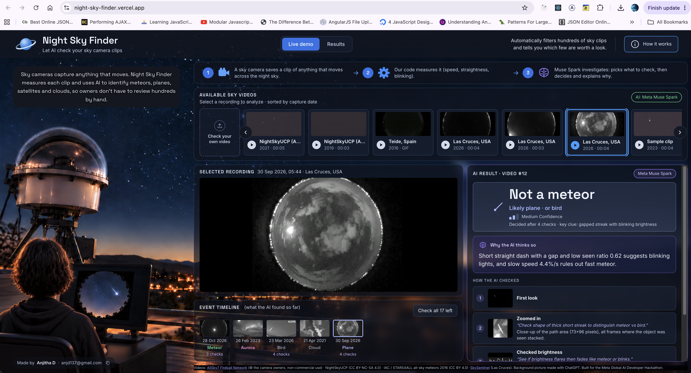

# Night Sky Finder

**Let AI check your sky camera clips.**

Sky cameras record anything that moves at night: meteors, but also planes, satellites, birds, insects, clouds, lightning and aurora. One camera can save hundreds of clips a night, and owners check them by hand.
Night Sky Finder measures each clip with Python, then **Meta's Muse Spark** investigates it like a detective, decides **"meteor or not"**, and explains why in plain words.

- **Live demo:** https://night-sky-finder.vercel.app (each clip takes about 10–40 seconds: the server measures it, then the AI investigates)
- **Demo video (3 min):** https://youtu.be/VtdyE3CDlPk

Built for the **Meta Global AI Developer Hackathon** (Indie track), by Anjitha D.

## Built during the hackathon

- **Everything in this repo was written during the event** (Oct 26 – Nov 4, 2026). The first commit is from Oct 27, 2026; see the commit history.
- **No code existed before the event.** The only outside code is open-source libraries, used as normal dependencies:
  - Backend: FastAPI, Uvicorn, OpenCV, NumPy, Pydantic, python-dotenv, and the OpenAI Python SDK (used only as an HTTP client for Meta's API). Full list: `backend/requirements.txt`.
  - Frontend: React, Vite, and the Inter and Space Grotesk fonts. Full list: `frontend/package.json`.

## Meta models used

| Model | Where it runs | What it does here |
|---|---|---|
| **Muse Spark 1.3** (`muse-spark-1.3`) | **Meta Model API** (`https://api.meta.ai/v1`, Responses API with tool calling) | Looks at the measurements and 2 pictures of each clip, chooses up to 3 checks with the 5 tools, then answers "meteor or not", the type, a confidence level and the reason. Also used on its own (watching the video, or 8 frames) as the baseline in the tests. |

No other Meta models are used. Nothing runs on Baseten or on my own GPUs: the measuring is plain Python (OpenCV) on a small server, and all AI calls go to the Meta Model API.



## Results

Meteor or not, checked against experts. "Not sure" counts as not right.

| Test set | Night Sky Finder | Muse Spark watching the video | Muse Spark looking at 8 frames |
|---|---|---|---|
| **NightSkyUCP**: 200 clips (100 meteors, 100 not), each checked by 5 experts | **85% right**, 13% not sure, 3% wrong | 35% right | 40% right |
| **AllSky7**: 33 clips, named by the network | **70% right** | 48% right | 55% right |

- When Night Sky Finder says "meteor" on the expert set, it is right **76 of 79** times.
- Cost: about **$0.01 per clip**.
- Every row is in the **Results** tab of the live demo.
- The AllSky7 set is small, and some of its clips were also used while I improved the code, so it is not a blind test. See [LIMITATIONS.md](LIMITATIONS.md).

## How it works

```
sky clip ──► 1. Python measures ──► 2. Muse Spark investigates ──► 3. answer + reason
            speed, straightness,     looks at 2 pictures, picks       "Meteor / Not a meteor",
            time visible, blinking,  up to 3 checks, then decides     the type, and why
            whole-sky flash
```

**1. My code measures (OpenCV + NumPy)**
- Finds what moved between frames and follows the main moving object.
- Measures speed (% of the screen per second), straightness (1 = perfectly straight), how long it is visible, and whether it blinks.
- Spots whole-sky flashes (lightning) and the whole sky getting brighter (a fireball lighting up the sky).
- Handles hard cases: faint objects on a bright sky, long videos, several satellites one after another.
- Makes 2 pictures for the AI: all frames stacked with the still sky removed, and one normal frame (to see clouds, aurora, daylight).

**2. Muse Spark investigates (Meta Model API, Responses API with tool calling)**

The AI gets the numbers and the 2 pictures. If it is not sure yet, it can call up to **3 tools**, and must say **why** for each one:

| Tool | What it shows |
|---|---|
| `zoom_in` | A close-up of the object's path: dotted (blinking plane), smooth (satellite), or with a tail (meteor) |
| `frames_over_time` | 4 close-up frames: how the object moved and changed |
| `brightness_curve` | Brightness in each frame: flare, fade, steady or blinking |
| `where_in_sky` | How far from the centre of the round camera picture (edge = horizon) |
| `watch_video` | 8 frames spread over the whole clip (costs the most, used last) |

Clear clips are decided after one look, so they stay cheap. Unclear clips get more checks.

**3. The answer**

"Meteor", "Maybe a meteor", "Not a meteor" or "Not sure", then the type (meteor, satellite, plane, bird, insect, cloud, sky flash, aurora, space junk burning up), a confidence level, a reason in plain words, and every check the AI made.

Nothing is saved: every click asks the AI again, live.

## Run it yourself

You need Python 3.12 and Node 20+.

**Backend**
```bash
cd backend
python -m venv .venv
source .venv/bin/activate
pip install -r requirements.txt
```
Copy `.env.example` to `.env` in the main project folder, and put your Meta Model API key in it:
```bash
cp .env.example .env
```
Never commit `.env` (it is in `.gitignore`). To try it **without any key or account**, set `AI_MODE=mock`: simple rules answer instead of the AI.
```bash
uvicorn skyfinder.api:app --reload
```

**Frontend**
```bash
cd frontend
npm install
npm run dev
```
Open http://localhost:5173. To use another backend, set `VITE_API_URL`.

**Tests** (no key needed)
```bash
cd backend
pip install pytest
python -m pytest -q
```

**Re-run the comparison** (uses the Meta API, costs tokens)
```bash
cd backend
python scripts/compare_ai_alone.py --folder data/nightskyucp_test --name NightSkyUCP_results --run-ours --how video
python scripts/compare_ai_alone.py --folder data/nightskyucp_test --name NightSkyUCP_frames --how frames
python scripts/make_results.py
```

## Recorded runs (to check the work without re-running it)

Every AI answer from the tests is saved, so the results can be checked without an API key:
- `backend/results/NightSkyUCP_results.json`: the 200 expert-checked clips, with the expert label, Night Sky Finder's full answer (type, confidence, reason, number of checks, tokens) and Muse Spark's answer when it watched the video alone.
- `backend/results/NightSkyUCP_frames.json`: Muse Spark's answers when it saw 8 frames.
- `backend/results/AllSky7_results.json` and `AllSky7_frames.json`: the same for the 33 AllSky7 clips.
- `frontend/public/results.json`: the summary shown in the Results tab.
- `docs/sample_run.json`: one full live investigation (measurements, every tool the AI chose and why, and the final answer).

## Project layout

```
backend/
  skyfinder/
    measure.py    measuring the moving object (OpenCV)
    tools.py      the 5 tools the AI can call
    agent.py      the investigation loop with Muse Spark
    classify.py   the guide for the AI and the answer format
    api.py        FastAPI server
  scripts/        test runs, results, helpers
  tests/          pytest tests
  results/        saved test results
  data/sample/    demo clips
frontend/         React (Vite) app: Live demo and Results tabs
```

## Credits

**Videos**
- **NightSkyUCP dataset:** M. Hofmann, R. Sennlaub, M. Hankey, M. Ennes, T. Müller, P. Kroll, P. Mäder (2022), [doi.org/10.6084/m9.figshare.16451625](https://doi.org/10.6084/m9.figshare.16451625), licence [CC BY 4.0](https://creativecommons.org/licenses/by/4.0/). Paper: [doi.org/10.1093/mnras/stac1948](https://doi.org/10.1093/mnras/stac1948). Clips were cut and processed for this project.
- **AllSky7 Fireball Network:** [allsky7.net](https://allsky7.net). Copyright: the camera owners, AllSky7 Fireball Network. Used for non-commercial purposes only.

  | Clip | Station (camera) | Place | Copyright |
  |---|---|---|---|
  | `2026_03_08_17_55_..._010763` | [AMS76](https://herkenrath.allsky7.net) (010763) | Herkenrath, Germany | Bernd Klemt, AllSky7 Fireball Network |
  | `2026_03_23_18_27_..._012661` | [AMS266](https://lindenberg.allsky7.net) (012661) | Lindenberg, Germany | André Knöfel, AllSky7 Fireball Network |
  | `2026_05_15_01_29_..._010091` | [AMS16](https://ketzuer.allsky7.net) (010091) | Ketzür, Germany | Sirko Molau, AllSky7 Fireball Network |
  | `non_meteor_2023_02_26_21_15_..._011195` | [AMS119](https://gaustatoppen.allsky7.net) (011195) | Gaustatoppen, Norway | Steinar Midtskogen, AllSky7 Fireball Network |
  | `non_m_2022_10_30_03_54_..._011193` | [AMS119](https://gaustatoppen.allsky7.net) (011193) | Gaustatoppen, Norway | Steinar Midtskogen, AllSky7 Fireball Network |
  | `non_m_2023_11_09_00_57_..._010885` | [AMS88](https://hoyerswerda.allsky7.net) (010885) | Hoyerswerda, Germany | Peter Lindner, AllSky7 Fireball Network |
- **IAC / STARS4ALL all-sky meteors 2016** (Teide, Tenerife), licence CC BY 4.0.
- **SkySentinel** network, Las Cruces, USA: [goskysentinel.com](https://goskysentinel.com).

**Other (non-Meta parts)**
- Website background picture and the "tired sky watcher" picture in the video: made with ChatGPT.
- Demo video narration: the macOS built-in voice "Zoe (Premium)".
- Demo video music: "Warm Memories" by Keys of Moon (chosic.com).
- OpenAI Python SDK: only used as the HTTP client to call the Meta Model API (no OpenAI models are used).

## More

- [LIMITATIONS.md](LIMITATIONS.md): what it does not do well yet
- [ROADMAP.md](ROADMAP.md): what could come next

---

© 2026 Anjitha D. All rights reserved. The code is shared for viewing and judging only. The videos keep their own licences (see Credits).